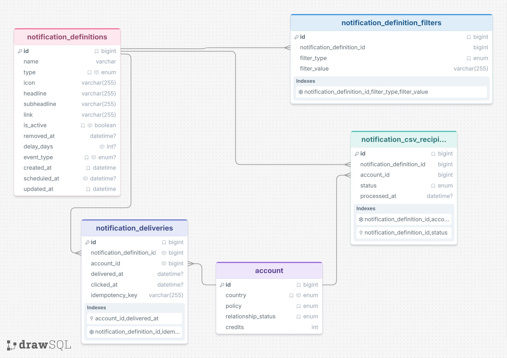

# Architecture and Design Choices
Will use this file to explain how the system is designed and why. This will elaborate on tradeoffs, assumptions, and decisions made throughout the development process.
## Project Overview:
The Book of the Month notification center is a backend service responsible for managing notification definitions, determining which specific members should receive notifications, and tracking notifications delivered to indicidual members.

This service supports three types of notification mechanisms:

1. Filter-based: Notifications targetted at members based on a user account attributes, including country (US or CA), membership policy (monthly, annual), relationship status (new member, friend, or BFF), and available credits

2. CSV upload: One-time notifications sent to a specified list of user account IDs

### DB Design Choices and Tradeoffs

- Create separate tables for notification definitions and notification deliveries. Notification definitions define the fields and values that are sent/displayed for a user. This acts as the notification campaign. The deliveries table contains the information for the specific delivery for the specific user, referencing the deliveries table

- Idempotency key. For the purpose of this project I designed the idempotency key for notification_deliveries to be the `${notificationDefinitionId}:${accountId}:${minute}`. This restricts the same notification definition to be sent to a user within the same minute. This current implementation allows for a user to receive the same notification in the same day (e.g. two shipments in the same day) but not in the same minute. Ideally in production, this key would be built using a specific attribute from the notification source, for example order ID or event ID.

- I've built a basic assumption on what the accounts table could possibly look like.

- Multiple rows per notification_definition for different filters vs one row containing all filters. I chose to have multiple rows per definition instead of storing all filters in one single row for each definition. This is a trade off (space vs cleanliness) but in my opinion this approach is much more readable and prevents the possibility of bad data in our filters

### Possible Failure Scenarios
- I identified a failure scenario where CSV deliveries could be created without recipients being marked as process. Originally I had one DB transaction where I was adding a delivery to notification_deliveries and then a separate transaction to mark the recipient as processed in notification_csv_recipients. I changed this to do both transactions atomically and avoid this edge case where one transaction succeeds and the other fails